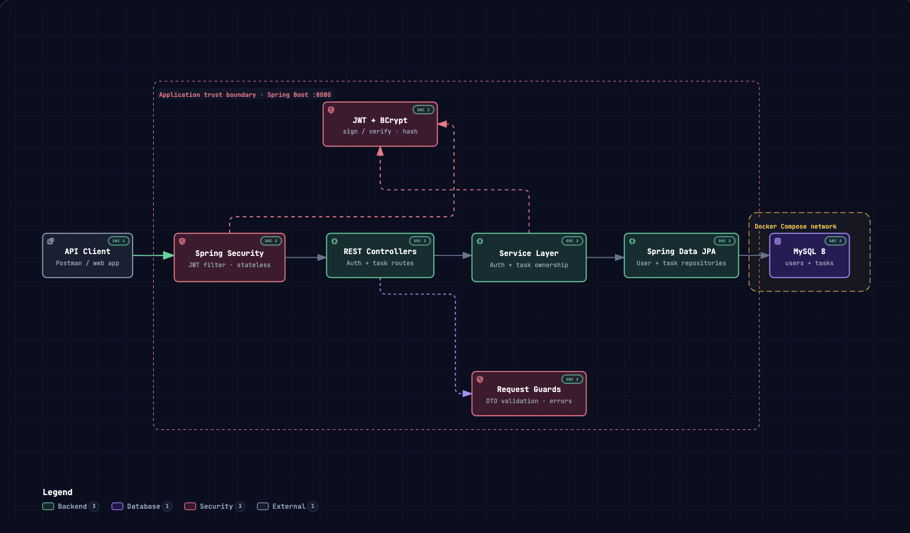

# 🛡️ Secure Task Management RESTful API

A production-grade, secure RESTful Task Management backend application built with **Java 17**, **Spring Boot 3.3.3**, **Spring Security 6**, **Spring Data JPA**, **MySQL 8.0 (Docker)**, and **JWT (JSON Web Token)** stateless authentication.

---

## 📚 Documentation Index
For deep-dive technical explanations and interview preparation, refer to the guides in the [`docs/`](./docs) folder:
* 🏛️ **[Project Structure & Architecture Walkthrough](./docs/PROJECT_STRUCTURE_AND_WALKTHROUGH.md)** — Package breakdown, request lifecycles, and how to present this project in interviews.
* 🛡️ **[Spring Boot 3 & Spring Security 6 Concepts](./docs/SPRING_BOOT_SECURITY_CONCEPTS.md)** — In-depth guide on annotations, SecurityFilterChain, JWT anatomy, JPA mechanisms, and interview Q&A.

---

## 📌 Features

- **🔐 Stateless Authentication & Authorization:** Secure JWT-based authentication using modern JJWT 0.12.x and BCrypt password hashing.
- **🛡️ Strict Multi-Tenant Data Isolation:** Users can only view, update, and delete their own tasks, preventing Insecure Direct Object Reference (IDOR) attacks.
- **👥 Role-Based Access Control (RBAC):** Extensible roles (`USER`, `ADMIN`).
- **🌐 Cross-Origin Resource Sharing (CORS):** Configured for decoupled frontend clients (React/Vite, Vercel deployments) with environment-driven origins and preflight handling.
- **🐳 Dockerized Database:** Instant MySQL 8.0 setup via Docker Compose on port `3307`.
- **✅ Input Validation & Sanitization:** Jakarta Validation (`@Valid`, `@NotBlank`, `@Email`, `@Size`).
- **🌐 Centralized Exception Handling:** `@RestControllerAdvice` returning uniform JSON error responses across all endpoints.
- **🗄️ ORM & Schema Automation:** Spring Data JPA / Hibernate with automated table and constraint generation.
- **⚡ Layered Clean Architecture:** Strict separation of concerns (`Controller` $\rightarrow$ `Service` $\rightarrow$ `Repository` $\rightarrow$ `MySQL`).

---

## 🛠️ Technology Stack

| Component | Technology | Version |
| :--- | :--- | :--- |
| **Language** | Java (LTS) | 17 |
| **Framework** | Spring Boot | 3.3.3 |
| **Security Engine** | Spring Security (Stateless FilterChain + CORS) | 6.3.3 |
| **Token Authentication** | JJWT (Java JWT) | 0.12.6 |
| **Password Hashing** | BCrypt Password Encoder | Built-in |
| **Persistence / ORM** | Spring Data JPA / Hibernate | 6.5.2 |
| **Database** | MySQL (Containerized) | 8.0 |
| **Containerization** | Docker & Docker Compose | Latest |
| **Validation** | Jakarta Bean Validation | 3.0.2 |
| **Boilerplate Reduction** | Project Lombok | Latest |
| **Build Tool** | Apache Maven Wrapper | 3.8+ |

---

## 🏗️ Architecture & Request Lifecycle



```
Client (React/Vite Frontend / Postman / Vercel App)
   │
   │ 1. HTTP / Preflight Request (OPTIONS or GET/POST/PUT/DELETE)
   ▼
┌─────────────────────────────────────────────────────────────┐
│  CorsFilter (CorsConfigurationSource)                       │
│  - Checks Origin against allowed origins (local / Vercel)   │
│  - Responds to preflight OPTIONS immediately with 200 OK    │
│  - Injects Access-Control-Allow-* headers on all responses  │
└──────────────────────────────┬──────────────────────────────┘
                               │ 2. Request with Authorization: Bearer <JWT>
                               ▼
┌─────────────────────────────────────────────────────────────┐
│  JwtAuthenticationFilter (OncePerRequestFilter)             │
│  - Extracts Bearer token from Authorization header           │
│  - Validates cryptographic signature and expiration         │
│  - Sets authenticated user into SecurityContextHolder       │
└──────────────────────────────┬──────────────────────────────┘
                               │ 3. Authenticated Request
                               ▼
┌─────────────────────────────────────────────────────────────┐
│  Controller Layer (AuthController / TaskController)         │
│  - Validates request DTOs (@Valid)                          │
│  - Extracts Principal (logged-in user email)                │
└──────────────────────────────┬──────────────────────────────┘
                               │ 4. Clean DTOs & Principal
                               ▼
┌─────────────────────────────────────────────────────────────┐
│  Service Layer (AuthService / TaskService)                  │
│  - Executes business logic                                  │
│  - Enforces strict user ownership & data isolation          │
└──────────────────────────────┬──────────────────────────────┘
                               │ 5. Domain Operations
                               ▼
┌─────────────────────────────────────────────────────────────┐
│  Repository Layer (Spring Data JPA)                         │
│  - findByUserOrderByCreatedAtDesc(user)                     │
│  - Automated SQL parameterization (SQL Injection immunity)  │
└──────────────────────────────┬──────────────────────────────┘
                               │ 6. SQL Queries
                               ▼
┌─────────────────────────────────────────────────────────────┐
│  MySQL Database in Docker (Port 3307:3306)                  │
│  - 'users' and 'tasks' tables                               │
└─────────────────────────────────────────────────────────────┘
```

---

## 🚀 How to Open and Run This Project

### 1. Prerequisites
* **Java 17 or higher:** `java -version`
* **Docker Desktop:** Installed and running on your machine.
* **Node.js 18+ & npm:** For the optional React/Vite frontend.

---

### 2. Step-by-Step Setup

#### Step A: Start the MySQL Database with Docker
Open your terminal in the project root directory and run:
```bash
docker compose up -d
```
*(This starts a MySQL 8.0 container on port `3307` with database `task_management_db` and password `password`).*

To verify MySQL is running:
```bash
docker ps
```

#### Step B: Start the Spring Boot Backend
In the same terminal (or new tab), run:
```bash
./mvnw spring-boot:run
```
*(On Windows, use `mvnw.cmd spring-boot:run`)*

The backend API will start on **`http://localhost:8080`**.

#### Step C: Start the React/Vite Frontend (Optional)
In another terminal tab, navigate to the `frontend/` folder:
```bash
cd frontend
npm install
npm run dev
```
Open the printed local URL (e.g. `http://localhost:5173`) in your browser to interact with the full UI.


---

## 📡 REST API Documentation

### 1. Authentication Endpoints (Public)

#### 🔹 Register a New User
* **URL:** `POST /api/auth/register`
* **Request Body:**
```json
{
  "name": "Rahul Negi",
  "email": "rahul@example.com",
  "password": "Password123"
}
```
* **Response (`201 Created`):**
```json
{
  "message": "User registered successfully"
}
```

---

#### 🔹 Login & Obtain JWT Token
* **URL:** `POST /api/auth/login`
* **Request Body:**
```json
{
  "email": "rahul@example.com",
  "password": "Password123"
}
```
* **Response (`200 OK`):**
```json
{
  "token": "eyJhbGciOiJIUzI1NiJ9.eyJyb2xlIjoiVVNFUiIsInN1YiI6InJhaHVsQGV4YW1wbGUuY29tIiwiaWF0IjoxNzI1OTYwMDAwLCJleHAiOjE3MjYwNDY0MDB9...",
  "tokenType": "Bearer",
  "email": "rahul@example.com",
  "role": "USER"
}
```

---

### 2. Task Endpoints (Protected — Require `Authorization: Bearer <token>`)

#### 🔹 Create a Task
* **URL:** `POST /api/tasks`
* **Header:** `Authorization: Bearer <JWT_TOKEN>`
* **Request Body:**
```json
{
  "title": "Complete Backend Placement Project",
  "description": "Secure Spring Boot Task API with JWT & Docker MySQL",
  "status": "IN_PROGRESS"
}
```
* **Response (`201 Created`):**
```json
{
  "id": 1,
  "title": "Complete Backend Placement Project",
  "description": "Secure Spring Boot Task API with JWT & Docker MySQL",
  "status": "IN_PROGRESS",
  "createdAt": "2026-09-22T04:00:00",
  "updatedAt": "2026-09-22T04:00:00"
}
```

---

#### 🔹 Get All Tasks for Logged-In User
* **URL:** `GET /api/tasks`
* **Header:** `Authorization: Bearer <JWT_TOKEN>`
* **Response (`200 OK`):**
```json
[
  {
    "id": 1,
    "title": "Complete Backend Placement Project",
    "description": "Secure Spring Boot Task API with JWT & Docker MySQL",
    "status": "IN_PROGRESS",
    "createdAt": "2026-09-22T04:00:00",
    "updatedAt": "2026-09-22T04:00:00"
  }
]
```

---

#### 🔹 Get Specific Task by ID
* **URL:** `GET /api/tasks/1`
* **Header:** `Authorization: Bearer <JWT_TOKEN>`
* **Response (`200 OK`):** Returns task details if owned by the logged-in user.

---

#### 🔹 Update Task
* **URL:** `PUT /api/tasks/1`
* **Header:** `Authorization: Bearer <JWT_TOKEN>`
* **Request Body:**
```json
{
  "title": "Complete Backend Placement Project",
  "description": "All endpoints tested and verified with Postman",
  "status": "COMPLETED"
}
```
* **Response (`200 OK`):** Returns updated task.

---

#### 🔹 Delete Task
* **URL:** `DELETE /api/tasks/1`
* **Header:** `Authorization: Bearer <JWT_TOKEN>`
* **Response:** `204 No Content`

---

## 🧪 Postman Testing Workflow

1. **Register User 1:** `POST /api/auth/register` with `user1@example.com`.
2. **Login User 1:** `POST /api/auth/login` and copy the `token`.
3. **Set Postman Auth:** In Postman, go to **Authorization** $\rightarrow$ Type: **`Bearer Token`** $\rightarrow$ Paste your token (no quotes).
4. **Create Task:** `POST /api/tasks` (Body: raw JSON) $\rightarrow$ Task ID 1 is created.
5. **Register & Login User 2:** `POST /api/auth/register` & `login` with `user2@example.com` and copy User 2's token.
6. **Verify Data Isolation:** With User 2's token, try to `GET /api/tasks/1` or `DELETE /api/tasks/1` $\rightarrow$ Returns **`403 Forbidden`**!

---

## 🛑 Standardized Error Responses

### Validation Error (`400 Bad Request`)
```json
{
  "timestamp": "2026-09-22T04:00:00",
  "status": 400,
  "error": "Bad Request",
  "message": "Validation failed for one or more fields",
  "path": "/api/auth/register",
  "validationErrors": {
    "email": "Email must be a valid email address",
    "password": "Password must be at least 6 characters long"
  }
}
```

### Unauthorized / Forbidden (`403 Forbidden`)
```json
{
  "timestamp": "2026-09-22T04:00:00",
  "status": 403,
  "error": "Forbidden",
  "message": "You do not have permission to access this task",
  "path": "/api/tasks/1"
}
```

---

## 🌐 CORS & Frontend Deployment (Local & Vercel)

The backend includes a pre-configured, production-ready CORS configuration integrated directly into the Spring Security 6 filter chain:

### 1. Default Behavior (Local Development)
- **Allowed Local Origins:** `http://localhost:5173`, `http://127.0.0.1:5173` (Vite dev servers).
- **Vite Proxy Support:** If you run the React app locally via `npm run dev`, Vite also proxies `/api` calls directly to `http://localhost:8080`.
- **Allowed HTTP Methods:** `GET`, `POST`, `PUT`, `DELETE`, `OPTIONS`.
- **Allowed Headers:** `Authorization`, `Content-Type`, `Accept`, `Origin`, `X-Requested-With`.
- **Exposed Headers:** `Authorization`.
- **Credentials:** Disabled (`allowCredentials: false`) for maximum security since authentication relies on stateless `Bearer` tokens in headers rather than session cookies.

### 2. Deployed Vercel / Cloud Frontend
When deploying your React frontend to Vercel (or another hosting platform), configure the following environment variables:

1. **On your Vercel Project Settings (Frontend):**
   ```env
   VITE_API_BASE_URL=https://your-backend-api.example.com
   ```
2. **On your Backend Server / Host (Spring Boot):**
   ```env
   CORS_ALLOWED_ORIGINS=https://your-frontend-project.vercel.app
   ```
   *(For multiple domains, separate by commas: `https://your-app.vercel.app,https://your-domain.com`)*

### 3. Verifying CORS Preflight via cURL
```bash
curl -i -X OPTIONS http://localhost:8080/api/tasks \
  -H "Origin: http://localhost:5173" \
  -H "Access-Control-Request-Method: GET" \
  -H "Access-Control-Request-Headers: Authorization"
```
**Expected Response:** `HTTP/1.1 200 OK` with `Access-Control-Allow-Origin: http://localhost:5173`.

---

## ⚙️ Environment Variables Reference

| Variable | Default Value | Description |
| :--- | :--- | :--- |
| `DATABASE_URL` | `jdbc:mysql://localhost:3307/task_management_db?...` | MySQL connection string |
| `DATABASE_USERNAME` | `root` | Database username |
| `DATABASE_PASSWORD` | `password` | Database password |
| `JWT_SECRET` | *Pre-configured 256-bit Hex Key* | Cryptographic secret for signing JWTs |
| `JWT_EXPIRATION` | `86400000` (24 hours) | Token expiration in milliseconds |
| `CORS_ALLOWED_ORIGINS` | `http://localhost:5173,http://127.0.0.1:5173` | Comma-separated list of allowed origins |

---

## 🧪 Automated Testing

Run the full test suite including CORS integration tests:
```bash
./mvnw test
```
To run only CORS verification tests:
```bash
./mvnw test -Dtest=CorsConfigurationTest
```

---

## 🛠️ Troubleshooting & Common Gotchas

### 1. Frontend White Screen or Hanging on `localhost:5173`
* **Stale Node Process / Port Fallback:** If an earlier dev server wasn't fully stopped, Vite will automatically switch to `http://localhost:5174/`. If the browser tries to connect to `5173`, it hangs or shows a blank page. Run:
  ```bash
  killall node
  cd frontend && npm run dev
  ```
  Check the exact URL printed in the terminal (e.g., `http://localhost:5173/`).
* **Cold Start Dependency Optimization:** On first launch without a pre-built `.vite/deps` cache, Vite's optimizer (`esbuild`) pre-bundles React packages. This can momentarily delay the first page load. Once cached, all subsequent reloads respond instantly.
* **Open via HTTP, Not Local File:** Never open `index.html` via `file:///` in your browser. Browsers block ES module scripts on the `file://` scheme.
* **Port Distinction:** Remember that `http://localhost:8080` is the backend Spring Boot REST API, while `http://localhost:5173` is the React frontend dashboard.

### 2. IDE Warning: *"Project configuration is not up-to-date with pom.xml"*
* In VS Code, press **`Cmd + Shift + P`** (Mac) or **`Ctrl + Shift + P`** (Windows/Linux).
* Type and select: **`Java: Update Project Configuration`** $\rightarrow$ select `taskmanager`.
* This syncs the IDE's Language Server model with `pom.xml`.

### 3. Database Connection Issues
* Verify the MySQL container is active: `docker ps`.
* If stopped, restart it with: `docker compose up -d`.
* Database port mapped is `3307` externally to `3306` internally.
